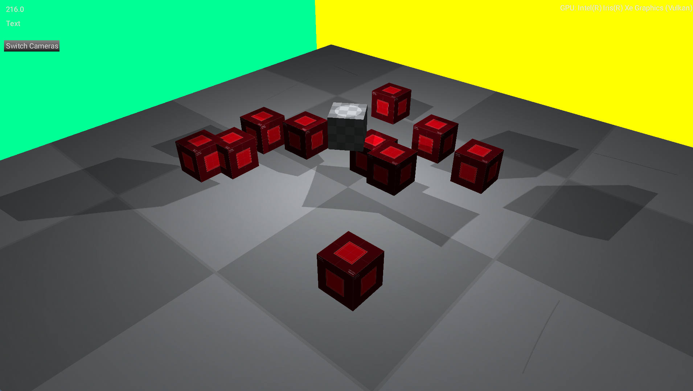
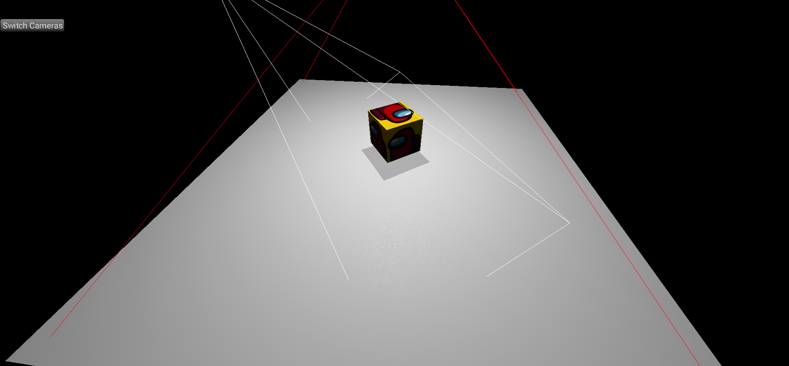
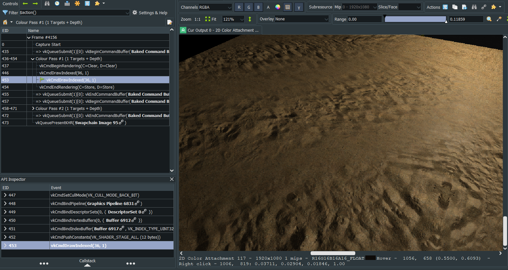
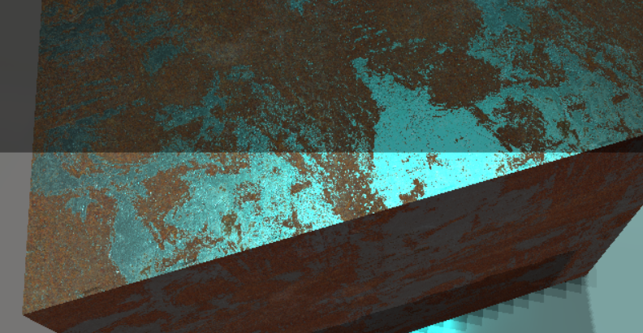

# Sky

## Cross-platform 3D Java game engine

- Cook-Torrance PBR rendering with the metallic/roughness workflow, frustum culling
- Supports Vulkan
- ECS with entity hierarchy
- Hot-Reloading Textures/Scripts/Shaders/Scenes
- Retained mode UI library
- Runtime SPIR-V shader reflection to find all uniforms
- Asset packaging through Kryo
- Serialization via the scene compiler 
- Support for custom render pipelines

PBR preview in RenderDoc

### License
Sky is licensed under the MIT license, available in the project root directory.